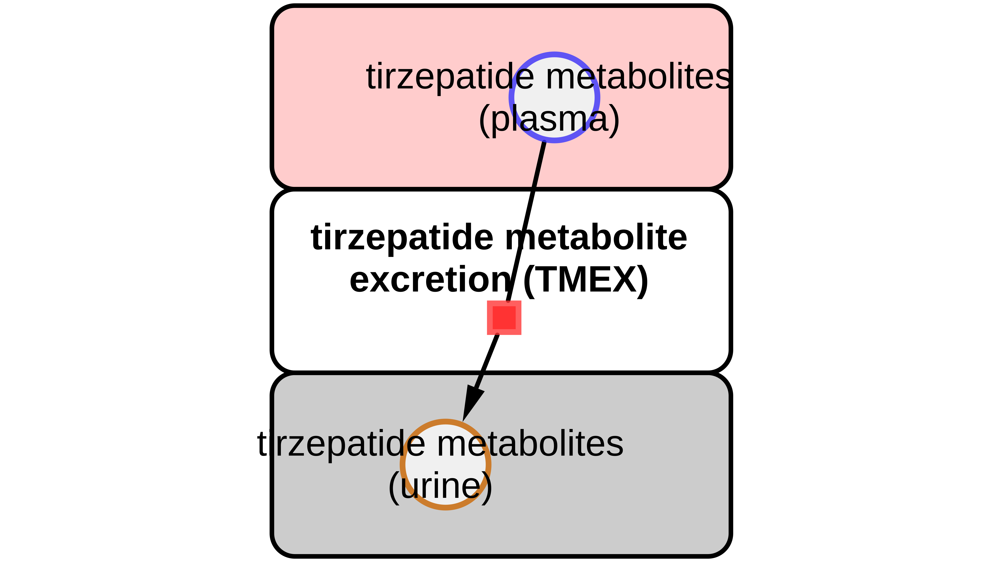

# Models

The models are distributed in [SBML](http://sbml.org) format.

## tirzepatide_body

* Model: [`tirzepatide_body.xml`](https://raw.githubusercontent.com/matthiaskoenig/tirzepatide-model/main/models/tirzepatide_body.xml)
* Equations: [`tirzepatide_body.md`](https://github.com/matthiaskoenig/tirzepatide-model/blob/main/models/tirzepatide_body.md)
* Report: [SBML4humans](https://sbml4humans.de/report?url=https%3A%2F%2Fraw.githubusercontent.com%2Fmatthiaskoenig%2Ftirzepatide-model%2Fmain%2Fmodels%2Ftirzepatide_body.xml)

## tirzepatide_body_flat

* Model: [`tirzepatide_body_flat.xml`](https://raw.githubusercontent.com/matthiaskoenig/tirzepatide-model/main/models/tirzepatide_body_flat.xml)
* Equations: [`tirzepatide_body_flat.md`](https://github.com/matthiaskoenig/tirzepatide-model/blob/main/models/tirzepatide_body_flat.md)
* Report: [SBML4humans](https://sbml4humans.de/report?url=https%3A%2F%2Fraw.githubusercontent.com%2Fmatthiaskoenig%2Ftirzepatide-model%2Fmain%2Fmodels%2Ftirzepatide_body_flat.xml)

## tirzepatide_intestine

* Model: [`tirzepatide_intestine.xml`](https://raw.githubusercontent.com/matthiaskoenig/tirzepatide-model/main/models/tirzepatide_intestine.xml)
* Equations: [`tirzepatide_intestine.md`](https://github.com/matthiaskoenig/tirzepatide-model/blob/main/models/tirzepatide_intestine.md)
* Report: [SBML4humans](https://sbml4humans.de/report?url=https%3A%2F%2Fraw.githubusercontent.com%2Fmatthiaskoenig%2Ftirzepatide-model%2Fmain%2Fmodels%2Ftirzepatide_intestine.xml)

{ style="max-height: 420px; width: auto; max-width: 100%" }

## tirzepatide_kidney

* Model: [`tirzepatide_kidney.xml`](https://raw.githubusercontent.com/matthiaskoenig/tirzepatide-model/main/models/tirzepatide_kidney.xml)
* Equations: [`tirzepatide_kidney.md`](https://github.com/matthiaskoenig/tirzepatide-model/blob/main/models/tirzepatide_kidney.md)
* Report: [SBML4humans](https://sbml4humans.de/report?url=https%3A%2F%2Fraw.githubusercontent.com%2Fmatthiaskoenig%2Ftirzepatide-model%2Fmain%2Fmodels%2Ftirzepatide_kidney.xml)

{ style="max-height: 420px; width: auto; max-width: 100%" }

## tirzepatide_liver

* Model: [`tirzepatide_liver.xml`](https://raw.githubusercontent.com/matthiaskoenig/tirzepatide-model/main/models/tirzepatide_liver.xml)
* Equations: [`tirzepatide_liver.md`](https://github.com/matthiaskoenig/tirzepatide-model/blob/main/models/tirzepatide_liver.md)
* Report: [SBML4humans](https://sbml4humans.de/report?url=https%3A%2F%2Fraw.githubusercontent.com%2Fmatthiaskoenig%2Ftirzepatide-model%2Fmain%2Fmodels%2Ftirzepatide_liver.xml)

## COMBINE archive

The models and the metadata are available as COMBINE archive from [`tirzepatide_model.omex`](https://raw.githubusercontent.com/matthiaskoenig/tirzepatide-model/main/tirzepatide_model.omex).
